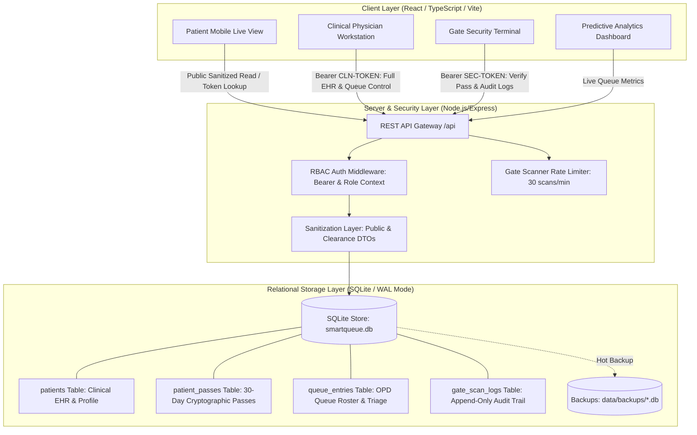

# SmartQueue — Hospital OPD Queue Management & Zero-Knowledge Gate System

SmartQueue is an end-to-end, privacy-centric hospital outpatient department (OPD) queue management system built for high-throughput ambulatory clinics. It replaces paper tokens and crowded corridors with dynamic digital tokens, real-time wait telemetry, and zero-knowledge 30-day QR hospital gate passes backed by local ACID-compliant SQLite storage.

---

## Architecture Overview



### Privacy & Least-Privilege Separation
- **Public Queue State (`GET /api/queue`)**: Strictly sanitized public DTO. Excludes patient full legal names, contact numbers, MRNs, medical complaints, allergies, and clinical notes. Displays masked identifiers (e.g. `PT-**042`).
- **Clinical EHR State (`GET /api/staff/queue`, `GET /api/staff/patient/:query`)**: Enforces `clinical` role credentials (`CLINICAL_AUTH_TOKEN`). Exposes full clinical records for attending physicians. Requests using security credentials receive **HTTP 403 Forbidden**.
- **Gate Clearance Terminal (`POST /api/scanner/verify`)**: Zero-Knowledge verification. Evaluates pass validity, expiration, revocation, and duplicate scans on the server. Strictly returns operational metadata (masked name, token, assigned clinic room). Excludes contact phone numbers, complaints, and medical history.
- **Dynamic 30-Day QR Pass**: The generated QR code embeds **only** a 128-bit cryptographic pass token (`SQ-PASS-...-B`). No personal or health information is embedded in the barcode.

---

## SQLite Database Storage Architecture

SmartQueue utilizes **SQLite 3** via `better-sqlite3` with **Write-Ahead Logging (WAL mode)** and strict foreign key constraint enforcement. All database operations reside exclusively on the backend; the raw database file is never accessible by or exposed to the client.

### 1. File Location & Storage
- **Primary Database**: `app/data/smartqueue.db`
- **WAL Journal**: `app/data/smartqueue.db-wal` (automatically managed)
- **Shared Memory**: `app/data/smartqueue.db-shm` (automatically managed)
- **Automated Backups**: `app/data/backups/smartqueue-backup-<timestamp>.db`
- **JSON Snapshot Mirror**: `app/data/smartqueue.json` & `app/data/gate_scans.json` (kept in sync for file-level audits)

### 2. Relational Schema & Table Definitions

```sql
PRAGMA journal_mode = WAL;
PRAGMA foreign_keys = ON;

-- 1. Patients Table: Legal profile & protected EHR records
CREATE TABLE patients (
  id TEXT PRIMARY KEY,                       -- e.g. "SJH-2025-8841"
  full_name TEXT NOT NULL,                   -- Full legal name (e.g. "Eleanor Vance")
  age INTEGER NOT NULL,                      -- 0 - 125
  gender TEXT NOT NULL DEFAULT 'Not Specified',
  contact_number TEXT NOT NULL,              -- Phone number
  mrn TEXT,                                  -- Medical Record Number (e.g. "SJH-98214-X")
  chief_complaint TEXT NOT NULL,             -- Clinical complaint (EHR only)
  allergies TEXT NOT NULL DEFAULT '["None reported"]', -- JSON string of allergies
  notes TEXT,                                -- Consultation notes
  created_at TEXT NOT NULL DEFAULT (datetime('now'))
);

-- 2. Patient Passes Table: 30-day cryptographic pass tokens & validity state
CREATE TABLE patient_passes (
  id TEXT PRIMARY KEY,                       -- Unique pass internal UUID
  patient_id TEXT NOT NULL,                  -- Foreign key -> patients(id)
  pass_token TEXT NOT NULL UNIQUE,           -- 128-bit token (e.g. "SQ-PASS-90412...-B")
  status TEXT NOT NULL DEFAULT 'active' CHECK (status IN ('active', 'expired', 'revoked')),
  issued_at TEXT NOT NULL DEFAULT (datetime('now')),
  expires_at TEXT NOT NULL,                  -- ISO 8601 string (30 days from issue)
  revoked_at TEXT,                           -- Populated when pass is revoked
  revocation_reason TEXT,
  FOREIGN KEY (patient_id) REFERENCES patients(id) ON DELETE CASCADE
);

CREATE INDEX idx_passes_token ON patient_passes(pass_token);
CREATE INDEX idx_passes_patient ON patient_passes(patient_id);

-- 3. Queue Entries Table: OPD departmental queues, triage priority, and visit state
CREATE TABLE queue_entries (
  id TEXT PRIMARY KEY,                       -- Unique queue entry UUID
  patient_id TEXT NOT NULL,                  -- Foreign key -> patients(id)
  token TEXT NOT NULL UNIQUE,                -- e.g. "MED-042", "CARD-013"
  department TEXT NOT NULL CHECK (department IN ('General Medicine', 'Cardiology', 'Orthopaedics')),
  room TEXT NOT NULL,                        -- e.g. "Room 104"
  doctor TEXT NOT NULL,                      -- e.g. "Dr. Sarah Jenkins, MD"
  status TEXT NOT NULL DEFAULT 'WAITING' CHECK (status IN ('WAITING', 'SERVING', 'HOLD_LAB', 'COMPLETED', 'CANCELLED')),
  triage_severity TEXT NOT NULL DEFAULT 'Routine' CHECK (triage_severity IN ('Routine', 'Urgent Priority', 'Senior Priority', 'Pediatric Fast-Track')),
  location TEXT NOT NULL DEFAULT 'Waiting Hall B',
  priority_score INTEGER NOT NULL DEFAULT 0,
  registered_at TEXT NOT NULL,
  called_at TEXT,
  completed_at TEXT,
  FOREIGN KEY (patient_id) REFERENCES patients(id) ON DELETE CASCADE
);

CREATE INDEX idx_queue_token ON queue_entries(token);
CREATE INDEX idx_queue_dept_status ON queue_entries(department, status);
CREATE INDEX idx_queue_patient ON queue_entries(patient_id);

-- 4. Gate Scan Logs Table: Append-only security audit trail
CREATE TABLE gate_scan_logs (
  id TEXT PRIMARY KEY,                       -- Scan event UUID
  pass_token TEXT NOT NULL,                  -- Scanned token
  patient_id TEXT,                           -- Foreign key -> patients(id) (ON DELETE SET NULL)
  outcome TEXT NOT NULL CHECK (outcome IN ('VALID', 'EXPIRED', 'REVOKED', 'INVALID')),
  gate_id TEXT NOT NULL DEFAULT 'Gate 02',
  operator_id TEXT NOT NULL DEFAULT 'SEC-402',
  timestamp TEXT NOT NULL,                   -- ISO 8601 scan timestamp
  is_duplicate INTEGER NOT NULL DEFAULT 0 CHECK (is_duplicate IN (0, 1)),
  warning_message TEXT,
  FOREIGN KEY (patient_id) REFERENCES patients(id) ON DELETE SET NULL
);

CREATE INDEX idx_scans_token ON gate_scan_logs(pass_token);
CREATE INDEX idx_scans_timestamp ON gate_scan_logs(timestamp);
```

### 3. Collision Prevention & ACID Transactions
- **Multi-Table Atomic Registration**: Every registration executes inside a `better-sqlite3` transaction (`db.transaction(...)`). Rows in `patients`, `patient_passes`, and `queue_entries` are committed together; if any constraint fails, the entire transaction rolls back.
- **Guaranteed Uniqueness**:
  - `isIdExists(id)` checks for collisions in `patients.id`.
  - `isTokenExists(token)` checks for collisions in `queue_entries.token`.
  - `isPassTokenExists(passToken)` checks for collisions in `patient_passes.pass_token`.
- **Durability**: Changes survive browser refreshes, application restarts, and backend crashes due to synchronous WAL write commits.

---

## Database Management: Initialization, Backup & Reset

### 1. Initialization & Safe Migration
When the server starts:
- If `data/smartqueue.db` does not exist, it is created automatically in `data/`.
- The schema and indexes are applied idempotently (`CREATE TABLE IF NOT EXISTS`).
- If the database is empty, `migrateFromJsonIfEmpty()` automatically migrates records from `data/smartqueue.json` (if present) or seeds initial synthetic demo records.
- Existing registered patient records are **never** overwritten on startup.

### 2. Creating a Database Backup
SmartQueue provides hot online backups using the SQLite Backup API.

**Via API (Staff Authorized)**:
```bash
curl -X POST http://localhost:3000/api/backup \
  -H "Authorization: Bearer sec-gate-token-402"
```
Response:
```json
{
  "success": true,
  "message": "Database backup initiated",
  "backupPath": "smartqueue-backup-2026-10-23T06-34-12-000Z.db",
  "timestamp": "2026-10-23T06:34:12.000Z"
}
```
Backups are saved to `app/data/backups/`.

**Programmatically**:
```typescript
import { backupDatabase } from './server/sqliteDb';
const backupFilePath = backupDatabase();
```

### 3. Resetting Demo Synthetic Data
To reset the database back to clean synthetic demo fixtures:

**Via API**:
```bash
curl -X POST http://localhost:3000/api/reset-demo
```
This safely clears transactions, reseeds demo patients with 30-day validity, resets scan logs, and clears the rate limiter.

---

## Environment Variables & Configuration

Configuration is managed via environment variables. See [`.env.example`](file:///app/.env.example):

| Variable | Default Value | Description |
|---|---|---|
| `PORT` | `3000` | Port on which Express and Vite listen |
| `NODE_ENV` | `development` | Set to `production` for static dist serving |
| `SECURITY_AUTH_TOKEN` | `sec-gate-token-402` | Bearer token for Gate Scanner verification, logs, and backups |
| `CLINICAL_AUTH_TOKEN` | `cln-med-token-104` | Bearer token for Clinical EHR queues, consultations, and charts |
| `VITE_CONFIG_NATIVE_IGNORE_WARNING` | `true` | Suppresses native config loader notice in modern Vite runtimes |

To customize credentials, copy `.env.example` to `.env`:
```bash
cp app/.env.example app/.env
```
*(Note: `.env`, `*.db`, `*.db-wal`, and `*.db-shm` are ignored by Git to prevent committing patient data or secrets.)*

---

## Installation & Running Locally

### Prerequisites
- **Node.js**: v18.0.0 or higher (v24.x tested and supported)
- **npm**: v9.0.0 or higher

### Step 1: Install Dependencies
```bash
cd app
npm install
```

### Step 2: Start Development Server
```bash
npm run dev
```
The application will launch on: **`http://localhost:3000`**

### Step 3: Production Build
```bash
npm run build
npm start
```

---

## Test Suites & Commands

SmartQueue features five automated test suites (**147 automated assertions**):

```bash
# Run all test suites back-to-back (176 assertions)
npm run test:all

# Run Indian Mobile Format & Form Verification Suite (23 assertions)
npm run test:indian

# Run SQLite Relational Persistence & Restart Recovery Suite (39 assertions)
npm run test:sqlite

# Run Multi-Patient Pass Registration Regression Suite (46 assertions)
npm run test:regression

# Run Database Persistence, Cryptography & Business Logic Suite (31 assertions)
npm run test

# Run HTTP REST Endpoints, Rate Limiting & RBAC Security Suite (20 assertions)
npm run test:security

# Run React UI Resilience & Form Watermark Verification Suite (17 assertions)
npm run test:ui

# Run TypeScript type check
npm run lint

# Compile production Vite assets
npm run build
```

### Test Coverage Breakdown

| Suite | File | Assertions | Focus Areas |
|---|---|---|---|
| **Indian Contact & Form Suite** | `test-indian-registration.ts` | **23** | Indian mobile format (`+91 XXXXX XXXXX`); duplicate prefix stripping; backend 10-digit validation starting with 6-9; empty name rejection; default `Male` gender persistence in SQLite. |
| **SQLite Relational Persistence** | `test-sqlite-persistence.ts` | **39** | SQLite tables and schema validation (`patients`, `patient_passes`, `queue_entries`, `gate_scan_logs`); foreign key constraints; WAL journal mode; multi-patient HTTP registrations; direct SQLite record inspection; pass status modification (`active` $\rightarrow$ `revoked`); scan audit logging into SQLite; online database backup API; persistence recovery across process restarts. |
| **Multi-Patient Regression** | `test-pass-registration-regression.ts` | **46** | Registers 3 distinct patients; verifies unique IDs, tokens, and pass tokens; validates distinct QR lookups; verifies gate scanner acceptance for each; tests server-side pass status transitions (active $\rightarrow$ expired $\rightarrow$ revoked); confirms persistence across server restarts. |
| **Store & Logic** | `test-smartqueue.ts` | **31** | JSON persistence & reload from disk; 128-bit cryptographic pass tokens; public DTO sanitization (no PHI); 5 scanner outcomes (valid, expired, revoked, invalid, duplicate); audit logging; queue calling workflow. |
| **HTTP & Security** | `test-http-security.ts` | **20** | Health check; public DTO privacy; 401 unauthenticated rejection; Security 200 OK clearance; HTTP responses for expired/revoked/invalid passes; RBAC 403 enforcement (Security blocked from Clinical EHR); Rate limiter (429 on 30+ req/min). |
| **UI Resilience** | `test-ui-resilience.ts` | **17** | React `ErrorBoundary` crash interception; null/empty queue states rendering without white-screens; sanitized DTO rendering; `RegisterView` clean empty inputs, Aryan watermark, and default Male selection. |
| **Total** | | **176** | **All 176 assertions passing with 0 failures.** |

---

## Hackathon Demo Workflow

Follow these steps for a complete local demonstration:


1. **Register a New Patient (`/register`)**:
   - Navigate to **Register Patient**.
   - Enter synthetic details:
     - Name: `Diana Prince`
     - Age: `32`
     - Phone: `(555) 300-1122`
     - Department: `General Medicine`
     - Complaint: `Acute migraine with visual aura`
   - Click **Generate My Digital Token**.
   - The backend creates linked records in SQLite `patients`, `patient_passes`, and `queue_entries` inside a single ACID transaction.
2. **Inspect the Unique Patient Pass (`/patient`)**:
   - The view automatically loads Diana's live queue status and assigned physician.
   - Click **View 30-Day Digital QR Pass**.
   - Verify Diana's unique 128-bit pass ID is displayed and encoded into the QR code.
   - Click **Simulate Status: Expired** or **Revoked** to see the pass update in SQLite in real time.
3. **Verify at Gate Security Terminal (`/staff` -> 'Security Terminal')**:
   - Switch to the Gate Security Terminal (`Officer T. Briggs`).
   - Notice the terminal is ready with Zero-Knowledge protection.
   - Click **Scan This Pass** (or type Diana's pass ID) and click **Verify Access Pass**.
   - The server verifies Diana's pass: returns **Access Granted** (or Expired/Revoked if status was toggled).
   - An audit row is immediately written to the SQLite `gate_scan_logs` table.
   - Click **Verify Access Pass** again immediately: notice the **Duplicate Scan Alert** with timestamp warning.
   - Click **Test RBAC: Query /api/staff/queue**: see the live server-enforced **HTTP 403 Forbidden** security response.
4. **Admit at Doctor Workstation (`/staff` -> 'Doctor Workstation')**:
   - Switch to Doctor Workstation (`Dr. Sarah Jenkins, MD`).
   - Find Diana Prince in the patient roster.
   - Notice you can click **Pass** directly from Diana's row to view/print her pass.
   - Click **View Chart** to inspect Diana's protected EHR details, allergies, and complaint.
   - Click **Call Next Patient** or complete the visit.
5. **Review Predictive Analytics (`/analytics`)**:
   - Inspect live metrics calculated from the database:
     - **Live Queue Length**: Real waiting count from `queue_entries`.
     - **Patients Served Today**: Discharged count.
     - **Estimated Average Wait Time**: Dynamic wait estimation.
     - Department caseload distribution and peak congestion forecasts.

---

## Synthetic Sample Data & Test Fixtures

All patient records, contact numbers, and identifiers in SmartQueue are synthetic demo fixtures:

| Token | Patient Name | Department | Pass Identifier | Seed Status / Outcome |
|---|---|---|---|---|
| `MED-042` | Eleanor Vance | General Medicine | `SQ-PASS-90412E5F6A7B8C9D0E1F-B` | Active Waiting (Valid Pass) |
| `MED-039` | Arthur Pendelton | General Medicine | `SQ-PASS-88210A1B2C3D4E5F6789-B` | Active Serving |
| `MED-040` | David Ross | General Medicine | `SQ-PASS-88320C3D4E5F6A7B8C9D-B` | Urgent Priority Waiting |
| `CARD-012` | Marcus Brody | Cardiology | `SQ-PASS-77110B8C9D0E1F2A3B4C-B` | Active Serving |
| `CARD-013` | Elena Gomez | Cardiology | `SQ-PASS-77190C9D0E1F2A3B4C5D-B` | Urgent Priority Waiting |
| `ORTH-024` | Thomas Wayne | Orthopaedics | `SQ-PASS-66100E1F2A3B4C5D6E7F-B` | Active Serving |
| `MED-088` | Walter White | General Medicine | `SQ-PASS-EXPIRED-TEST-FIXTURE-B` | **Genuinely Expired (35d ago)** |
| `MED-089` | Jesse Pinkman | General Medicine | `SQ-PASS-REVOKED-TEST-FIXTURE-B` | **Security Revoked** |

---

## Security Disclaimer & Prototype Limitations

1. **Prototype Status**: SmartQueue is a hackathon prototype designed for local demonstration and evaluation.
2. **Demo Tokens**: Default bearer tokens are provided for easy local evaluation. In a production environment, integrate with an enterprise identity provider (OAuth2/OIDC/SAML), hospital Active Directory, and TLS client certificates.
3. **Data Storage**: Storage utilizes a local SQLite database (`data/smartqueue.db`) with WAL mode. In high-availability multi-node deployments, migrate to an enterprise relational database (e.g., PostgreSQL with Row-Level Security) with encryption-at-rest.
4. **Synthetic Data**: Never enter real Protected Health Information (PHI) or personally identifiable information into this demo.
